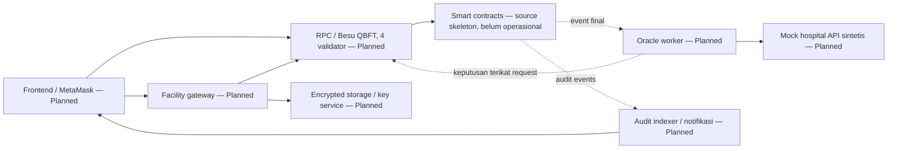

# Arsitektur dan keterbatasan

Diagram menunjukkan rancangan target. Saat ini hanya source skeleton kontrak, dokumentasi, serta scaffold frontend/oracle tersedia. Semua jalur runtime masih Planned.

## Batas kepercayaan dan data

- Wallet menandatangani transaksi. Gateway kelak membuktikan wallet lewat signed challenge, memeriksa otorisasi final dan status terkini, lalu melayani sesi baca singkat. Frontend bukan penegak keamanan tunggal.
- Smart contract direncanakan menyimpan metadata minimum, hash ciphertext, consent, request/grant, dan event. NIK, diagnosis, bukti klinis mentah, kunci, serta URL bertoken tidak boleh dimasukkan on-chain. Private chain tetap mereplikasi data ke peserta.
- Ciphertext, kunci, fakta klinis, dan pemetaan identitas tetap off-chain di fasilitas. Gateway harus memeriksa integrity ciphertext dan tidak membagikan storage URL langsung atau kunci. Enkripsi/key service belum diimplementasikan.
- Validator memeriksa aturan eksekusi dan konsensus, bukan kebenaran medis. Oracle bergantung pada sumber fasilitas yang terautentikasi dan dikelola independen dari pernyataan dokter; input emergency dari frontend saja tidak cukup.
- Empat container validator lokal direncanakan sebagai simulasi konsorsium; satu host tidak membuktikan hosting organisasi yang independen atau toleransi kegagalan antarfasilitas. Pengujian quorum belum tersedia.

## Alur target dan audit

Akses normal terikat patient consent, dokter, record, dan expiry. Break-glass membutuhkan request terbatas, verifikasi oracle, lalu grant read-only berumur pendek. Scope, status kredensial, penutupan, dan expiry harus diperiksa lagi saat penggunaan. Batas waktu dalam skeleton belum ditegakkan oleh metode bisnis.

Indexer kelak melanjutkan checkpoint dan melakukan deduplikasi untuk riwayat/notifikasi pasien. Auditor terpisah dari dokter pemohon melakukan review setelah penggunaan. Bukti klinis dibuka lewat prosedur off-chain tersendiri.

Event `AccessAuthorized` hanya bukti otorisasi yang tercatat, bukan bukti pengiriman atau pembacaan RME. Gateway perlu log hasil pengiriman dan percobaan gagal, lalu rekonsiliasi terhadap event final. Transaksi yang revert tidak menghasilkan event kontrak yang persisten.

Belum tersedia evaluasi latency, gas, confidentiality, expiry/revocation, ketahanan quorum, atau perbandingan SATUSEHAT. Lihat [setup](setup.md) dan [kontrak integrasi](integration-contract.md) untuk status handoff.
