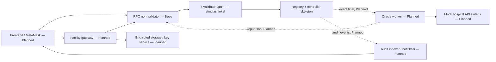

# Arsitektur dan batas kepercayaan

Infrastruktur menyediakan empat validator QBFT dan satu RPC non-validator. Source kontrak serta deployment tooling tersedia; operasi medis controller dan semua layanan aplikasi masih Planned.

## Infrastruktur dan trust boundaries

RPC host dibatasi ke 127.0.0.1:8545 dengan namespace ETH/NET/WEB3 serta explicit host/CORS allowlists. Container aplikasi bergabung ke network proyek dan memakai http://rpc:8545. Monitoring QBFT menggunakan loopback validator1 melalui probe operator, tanpa port host. Detail berada pada [panduan chain](private-chain.md).

Kelima node memakai node/account permissioning lokal dengan allowlist konsisten. Approval/funding akun merupakan tugas operator; registrasi role/fasilitas/kredensial dalam ParticipantRegistry adalah kontrol aplikasi terpisah. Local permissioning tidak mencegah peserta jahat menyalin atau membocorkan ledger. Empat container pada satu host tidak membuktikan hosting organisasi yang independen.

Validator memeriksa aturan eksekusi dan konsensus, bukan kebenaran medis. Oracle kelak bergantung pada API fasilitas terautentikasi yang dikelola independen dari pernyataan dokter. Form frontend saja tidak cukup membuktikan emergency.

## Data dan alur target

Metadata minimum, ciphertext hash, consent, request/grant, dan audit events direncanakan on-chain. NIK, diagnosis, bukti klinis mentah, encryption key, dan storage URL bertoken tidak boleh berada dalam calldata, event, atau storage kontrak. Ciphertext, kunci, pemetaan identitas, serta clinical facts tetap off-chain di fasilitas.

Gateway kelak membuktikan wallet melalui signed challenge, menunggu receipt otorisasi final, memeriksa scope/kredensial/expiry/revocation terkini, menguji integrity ciphertext, dan melayani sesi baca singkat tanpa membagikan kunci atau URL langsung. Normal access terikat patient consent; break-glass memerlukan keputusan oracle yang sah dan grant read-only terbatas.

Constructor registry/controller serta getter metadata tersedia, tetapi operasi medis belum dapat menerbitkan grant. Konstanta waktu pada skeleton belum membuktikan penegakan kebijakan. Lihat [kontrak](smart-contracts.md) dan [integrasi](integration-contract.md).

## Audit dan keterbatasan

Indexer/notifikasi kelak memakai checkpoint dan deduplikasi. Auditor berbeda dari dokter pemohon dan memeriksa penggunaan break-glass setelah akses. Pembukaan bukti klinis tetap memerlukan prosedur off-chain.

Event AccessAuthorized hanya membuktikan otorisasi yang tercatat, bukan pengiriman atau pembacaan RME. Gateway perlu log pengiriman dan kegagalan untuk rekonsiliasi. Transaksi revert tidak meninggalkan event kontrak yang persisten.

Pengujian chain, transaksi, dan deployment tidak membuktikan confidentiality sistem lengkap, oracle security, latency target, atau keunggulan dibanding SATUSEHAT. Hasil pengujian yang benar-benar dijalankan terdapat pada [setup](setup.md).
